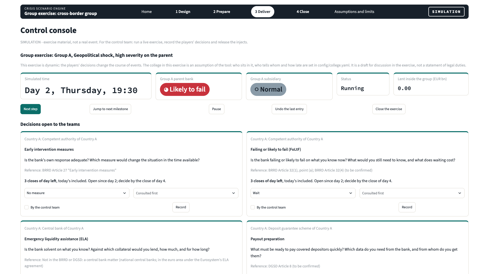

# Crisis Scenario Engine

[](https://github.com/Lorenzo-bianchi-lab/crisis-scenario-engine/actions/workflows/tests.yml) [](LICENSE)

**The day-by-day script of a bank crisis for a simulation exercise between authorities: consistent numbers for a fictitious bank, what each team knows and when, the decisions due, and a console to run the exercise live.**



## What it does

People who prepare a crisis simulation exercise (at a resolution authority, a supervisor, a central bank or a deposit guarantee scheme) need a crisis whose numbers hold together: what the bank has lost, what it can still raise, who has been told, which decision is due and what follows from each option. Writing those numbers by hand is slow, and they stop being consistent as soon as a decision changes the story. This tool generates them.

- **Simulates a fictitious bank day by day**: a deposit run, the liquidity stress that follows, the funding waterfall (cash, liquid assets, central bank, emergency liquidity, fire sales), the stages from recovery to failing or likely to fail, and the figures of resolution or liquidation.
- **Turns the run into an exercise script**: injects for each team, holding only the figures that team would have at that time; decisions with options, deadlines and who to consult; a main events list, role cards and a full-information pack for the control team.
- **Runs the exercise live**: a console for the control team with a simulated clock, a read-only page for each team, decisions recorded as they are taken and, in a dynamic exercise, a path that changes with them.
- **Drafts the closing report**: what was decided against the plan, which coordination steps were recorded, and what the model gives with one decision changed. Lessons learned are left to people.

The pages follow the four phases of an exercise in the EBA *Handbook on simulation exercises for resolution authorities* (EBA/REP/2025/20): design, prepare, deliver, close.

## Three kinds of exercise

| Kind | What is simulated | Teams |
|---|---|---|
| **Single bank** | One bank: four archetypes (universal, retail, online, specialised lender), five trigger scenarios (fast digital run, slow burn, cyber outage, geopolitical shock, loss revealed) | Competent authority, resolution authority, central bank, deposit guarantee scheme |
| **Cross-border group** | A parent and a subsidiary in two countries; liquidity moves inside the group; the host authority can ring-fence | The four authorities of each country, as a college |
| **System-wide** | Two unrelated banks of one country under stress at once; what is done to one changes the other's path | The same four authorities for both banks |

## Quick start

Python 3.11 or newer, macOS or Linux.

```bash
git clone https://github.com/Lorenzo-bianchi-lab/crisis-scenario-engine.git
cd crisis-scenario-engine
./start.sh
```

On first use `start.sh` creates a virtual environment in `.venv`, installs the dependencies and opens the app at http://localhost:8501. The app opens on a home page with a **demo tour** (nine stops across the pages and the three kinds of exercise), an **exercise already played** that loads in one click, and a **reset** button. Everything runs on your machine and needs no connection.

The control team's pages ask for a code: `control` (set in `config/script.yaml`, or with the environment variable `CRISIS_CONSOLE_CODE`). It prevents mistakes, it is not security.

On Windows, create the environment by hand and run `streamlit run app/main.py`.

### Without the app

```bash
# single bank: daily table and exercise pack
.venv/bin/python -m engine.run --showcase --export-dir exports
# cross-border group
.venv/bin/python -m engine.group --showcase --export-dir exports
# system-wide
.venv/bin/python -m engine.group --system --path early_foltf --export-dir exports
# a live exercise played by script
.venv/bin/python -m engine.live_run
```

Each command prints the daily figures; with `--export-dir` it writes the exercise pack as Word documents and CSV files. `--help` lists the options.

## How it works

Every model parameter lives in `config/*.yaml` with a value, a unit and a source; a value without a verifiable source is marked `ASSUMPTION`, and the app's *Assumptions and limits* page lists them all. The model is deterministic: the same inputs give the same script. Two archetypes' balance sheet proportions are calibrated on the EBA 2025 EU-wide Transparency Exercise; the speed of the runs is compared, as an order of magnitude only, with documented cases.

- [docs/METHODOLOGY.md](docs/METHODOLOGY.md): how the figures are produced and how far they can be trusted, for a reader from an authority.
- [docs/CALIBRATION.md](docs/CALIBRATION.md): which data file and column each sourced number comes from.
- [docs/LEGAL_REFERENCES.md](docs/LEGAL_REFERENCES.md): the legal references the tool can show (below).

### Legal references

Next to decisions, stages and resolution figures, the app and the documents can show a small "Reference:" line saying where the concept sits in EU law (BRRD, DGSD), from one file, `config/legal.yaml`. References are for orientation only: the tool does not model the legal conditions. Several are marked "to be confirmed". A switch, *Show legal references*, turns them off in the app; `--no-legal-references` does the same on the command line.

### Replies drafted by AI (off)

The console can draft a simulated stakeholder's reply to a team's unforeseen request with a general-purpose AI model, grounded only in that stakeholder's role card and figures, with a check that refuses any number it was not given, and sent only on the control team's click. It is **off as shipped and has not been tested with a real model**: it was built and tested with a fixed reply. To try it, see `config/ai.yaml`; a real call needs your own API key in the environment variable `ANTHROPIC_API_KEY`.

## Limits

It is not a supervisory model, a stress test, an early-warning system or a forecast, and it describes no real institution. Run-off speeds, the panic curve, haircuts, thresholds and information delays are assumptions; the sensitivity ranges are not probabilities; capital moves only through losses on sales and revealed losses; the run stops when a resolution tool is applied. The full list is in [docs/LIMITS.md](docs/LIMITS.md) and on the app's *Assumptions and limits* page.

## Project status

**Prototype, version 1.0.** University project, released publicly for anyone running crisis simulation exercises.

- The texts of injects, role cards, rules of play and coordination steps are drafts and **have not been reviewed by a practitioner**.
- The legal references are partly marked "to be confirmed".
- The AI-drafted replies are **prepared, not tested with a real model**.
- The Word documents were opened in Word by the author and render correctly; their content and structure are also tested.
- 1,959 automated tests run locally (`.venv/bin/pytest -q`, about 12 minutes); a fast subset runs on every push.

## The EBA Handbook

The tool's vocabulary, its four phases and the paragraph numbers cited in its code and documents refer to the *Handbook on simulation exercises for resolution authorities* (EBA/REP/2025/20, July 2025), published by the EBA: [EBA press release and download](https://www.eba.europa.eu/publications-and-media/press-releases/eba-publishes-handbook-simulation-exercises-resolution-authorities). It is not in this repository, and no part of the tool reads it: download it to check a paragraph. The tool is not an EBA product.

## Repository layout

```
app/        Streamlit app: pages, charts, console, team pages
engine/     the model and everything it produces (pure Python, no app code)
config/     every parameter, text and reference, in YAML
tests/      automated tests
docs/       methodology, calibration, limits, legal references, screenshots
scripts/    calibration from the public data file; conversion of the packs to PDF
dev/        development notes: specifications, plans, status, the notes for the coding assistant
```

## Author

University project, ESCP Business School, MiM. Lorenzo Bianchi.

## License

[MIT](LICENSE).

## How to cite

See [CITATION.cff](CITATION.cff); GitHub shows it under *Cite this repository*.

> Bianchi, L. (2026). *Crisis Scenario Engine* (Version 1.0) [Computer software]. University project, ESCP Business School, MiM. https://github.com/Lorenzo-bianchi-lab/crisis-scenario-engine
